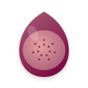

<p align="center">
  
</p>

<h1 align="center">Fig Jam Theme</h1>

<p align="center">
  A warm vintage Chrome theme in fig-jam tones — deep wine chrome over a pale peach page.
</p>

<p align="center">
  
  
  
  
</p>

<p align="center">
  
</p>

## Overview

Fig Jam pairs a deep wine frame with a slightly lighter claret toolbar, then opens onto a soft peach New Tab Page with an orange Google logo that warms the whole screen. Pale peach ink keeps every tab, bookmark and toolbar icon readable on the dark chrome, links take the wine tone again, and a single-row shortcut layout keeps the New Tab Page clean.

It is the warmest theme in the set: jammy wine, dusty rose and peach, with the chrome doing the heavy lifting so the page can stay light.

## Design Concept

The source palette is four steps of one warm red-purple — fig wine, claret, dusty rose and peach — tagged vintage and gradient. Because the darkest tone is genuinely deep, this theme can afford a dark chrome: wine takes the frame and toolbar, peach becomes the page *and* the ink on the chrome, and the two middle tones carry buttons and links.

| Color | Hex | RGB | Role |
|---|---|---|---|
| Wine | `#7C0E44` | 124, 14, 68 | Frame / New Tab links |
| Claret | `#8E1249` | 142, 18, 73 | Toolbar |
| Mauve | `#AA5E7A` | 170, 94, 122 | Buttons |
| Rose | `#D49A9A` | 212, 154, 154 | New Tab header / buttons |
| Peach | `#F2DACE` | 242, 218, 206 | New Tab background / chrome ink |
| Ink | `#4A0A28` | 74, 10, 40 | New Tab text |

## Features

- Pure color, no wallpaper — fast and distraction-free
- Warm vintage palette: wine, claret, rose and peach from one hue
- Dark wine chrome with pale peach ink — 7.8:1 on the frame
- Tab text, bookmark text and toolbar icons all share the same peach ink
- Single-row shortcut row and a color-matched Google logo for a clean New Tab Page
- No configuration needed — install and enjoy

## Screenshots

| Browser | Palette |
|:-:|:-:|
|  |  |

## Installation

### Load unpacked (development)

1. Download or clone this repository.
2. Open `chrome://extensions` in Chrome.
3. Enable **Developer mode** in the top right.
4. Click **Load unpacked** and select this folder (`fig-jam-theme`).
5. The theme is active immediately.

### Package for the Chrome Web Store

```
chrome://extensions → Pack extension → select this folder → fig-jam-theme.zip
```

Upload the resulting `.zip` to the [Chrome Web Store developer dashboard](https://chrome.google.com/webstore/devconsole).

## Store listing copy

Ready to paste into the store listing (also kept in `store-assets/store-description.txt`):

> Fig Jam is a warm vintage Chrome theme: deep wine chrome, a soft peach New Tab Page, and an orange Google logo that warms the whole screen. Pale peach ink keeps every tab, bookmark and toolbar icon readable on the dark frame. Solid colors only, no wallpaper.

## Project structure

| File | Purpose |
|---|---|
| `manifest.json` | Theme definition (single-file, inlined `theme` field) |
| `logo/logo.png` | 128×128 store icon (transparent background) |
| `store-assets/promo/440x280.png` | Small promo tile |
| `store-assets/promo/1400x560.png` | Marquee promo tile |
| `store-assets/screenshots/en/screenshot-1-browser.png` | Browser mockup screenshot (1280×800) |
| `store-assets/screenshots/en/screenshot-2-palette.png` | Palette introduction screenshot (1280×800) |
| `store-assets/store-description.txt` | Store listing description |
| `scripts/generate-logo-vector.py` | Render all SVG logo candidates with headless Chromium, build contact sheets, export `logo/logo.png` from `SELECTED` |
| `scripts/generate-screenshot-headless.py` | Regenerate the browser mockup via Playwright |
| `scripts/generate-screenshot-2-palette.py` | Regenerate the palette screenshot |
| `scripts/generate-promo.py` | Regenerate both promo tiles (1400×560 window hero, 440×280 dot palette) |
| `LICENSE` | Non-Commercial License (English / 中文) |

## Regenerating assets

Every asset is code-generated, so nothing here is hand-drawn or hand-copied:

```bash
py -3 scripts/generate-logo-vector.py         # candidates + contact sheets + logo/logo.png
py -3 scripts/generate-screenshot-headless.py # store screenshot 1 (browser mockup)
py -3 scripts/generate-screenshot-2-palette.py # store screenshot 2 (palette)
py -3 scripts/generate-promo.py               # promo 440x280 + 1400x560
```

To ship a different icon candidate, change `SELECTED` at the top of `generate-logo-vector.py` and re-run, then re-run the three asset scripts so the promo and screenshots pick up the new logo.

## License

Fig Jam Theme is released under the Non-Commercial License. See `LICENSE` for full text (English / 中文).
